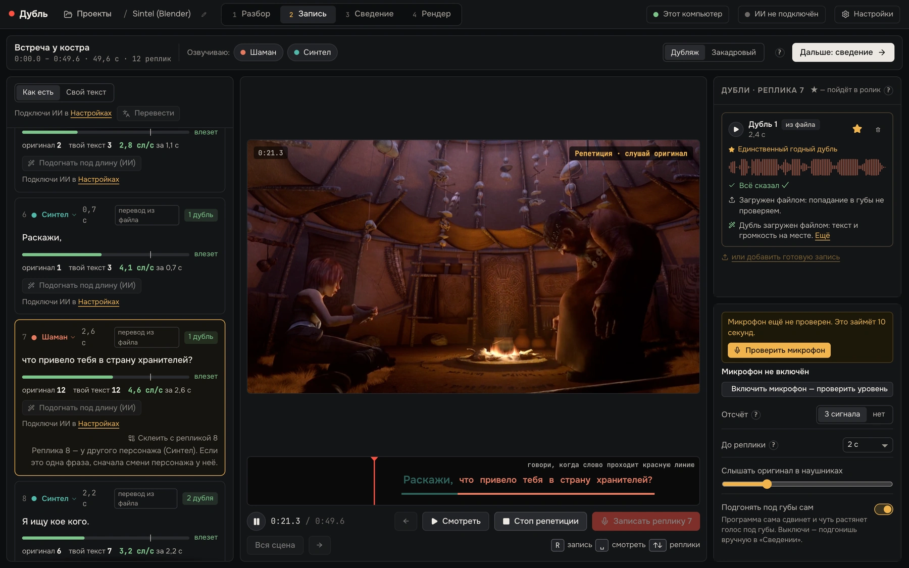
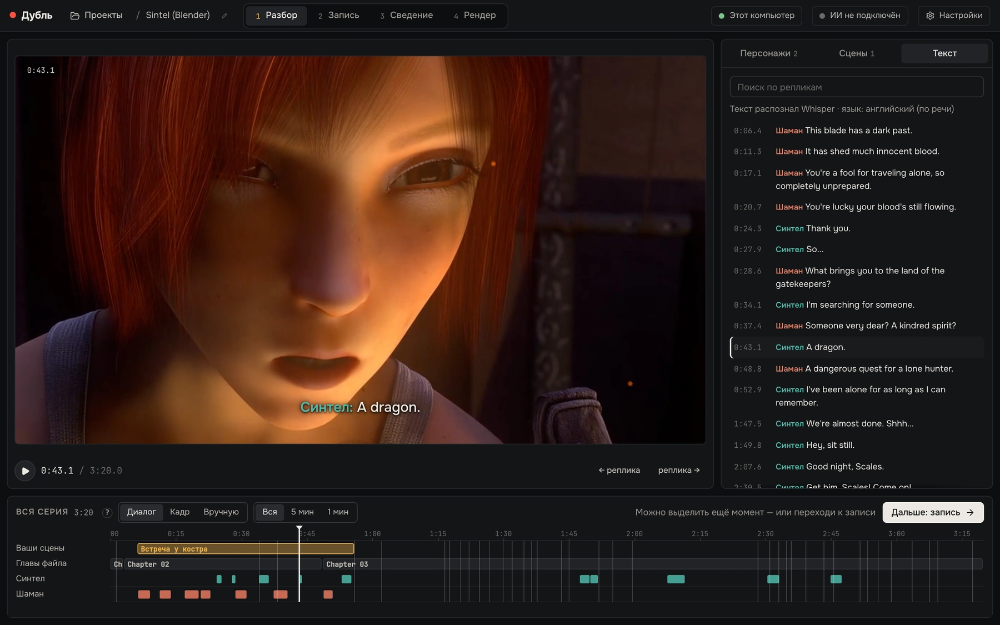
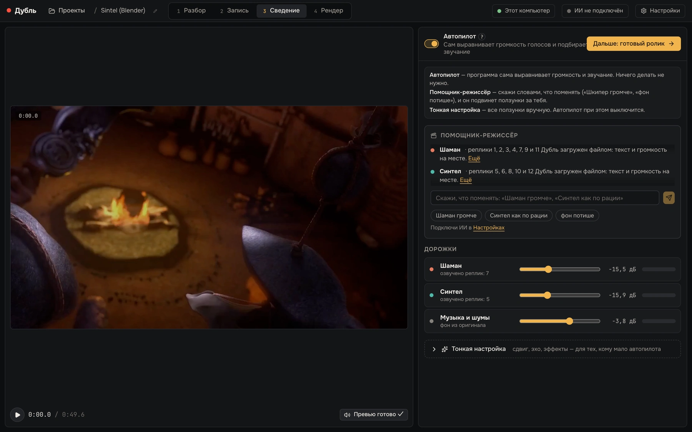
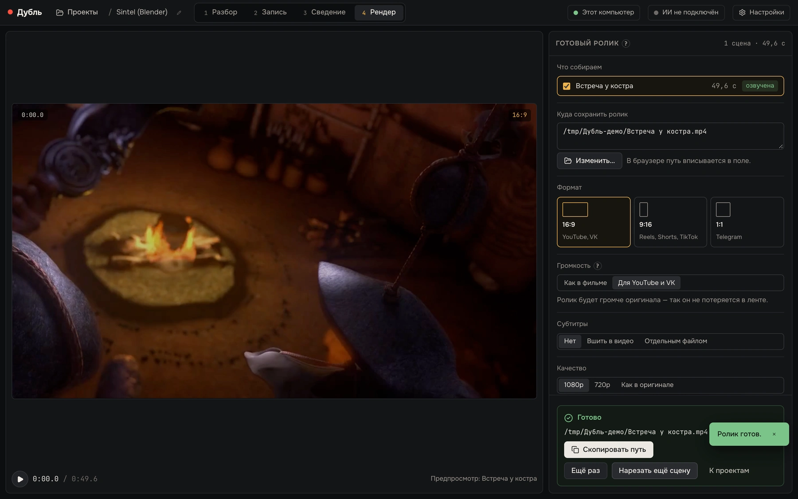
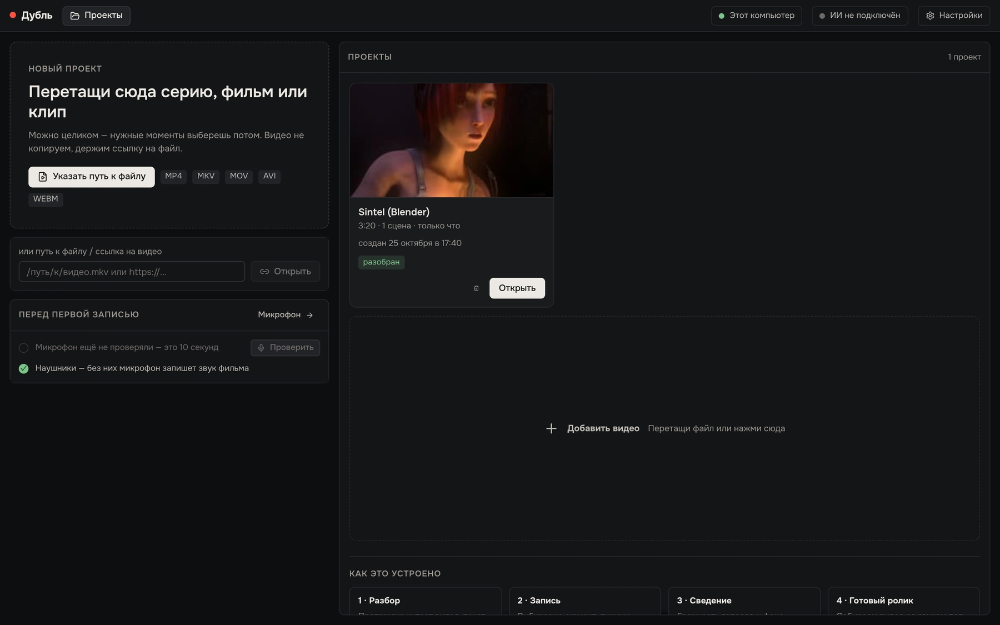

# Дубль

Бесплатная программа с открытым кодом для любительской озвучки мультфильмов, аниме и кино. Открываешь видео, выбираешь реплику, говоришь в микрофон, получаешь готовый ролик. Монтаж и сведение берёт на себя программа.



<sub>Запись реплики: смотришь кадр и говоришь, когда слово доходит до красной линии.</sub>

[](https://github.com/pingvin1337/dubl/actions/workflows/ci.yml)
[](LICENSE)

## Как это выглядит

Весь путь на одном коротком отрывке: программа разбирает фильм, ты записываешь реплики, она сводит звук и собирает ролик.

**1. Разбор.** Программа сама нашла речь, поделила её на реплики и два голоса. Голосам можно дать имена, а на шкале внизу видно, кто и когда говорит.



**2. Запись.** Это главный экран, он вверху страницы. Дубль можно записать с микрофона или добавить готовым файлом.

**3. Сведение.** Автопилот выравнивает громкость голосов и подбирает звучание, а фон остаётся от оригинала. Если что-то не так, можно сказать словами, что поменять.



**4. Готовый ролик.** Выбираешь формат (16:9, 9:16 или 1:1), громкость и субтитры, жмёшь «Собрать ролик» и получаешь mp4.



**Главный экран.** Сюда бросаешь видео, здесь же лежат твои проекты.



<sub>Кадры из фильма «Sintel» © Blender Foundation | durian.blender.org, CC BY 3.0. Голоса в дублях синтезированы системным голосом macOS: микрофона на съёмке не было, поэтому дубли добавлены файлами.</sub>

## Для кого

Для тех, кто хочет озвучить любимую сцену сам, но не хочет разбираться в звуковых редакторах. Программа не заменяет студию: ручного монтажа дорожек, клонирования голоса и ИИ-озвучки вместо тебя в ней нет и не будет (границы описаны в [docs/ABOUT.md](docs/ABOUT.md)).

## Что умеет

- Разбирает видео сама: распознаёт речь, делит её на реплики и по голосам. Использует субтитры, несколько дорожек и 5.1, если они есть в файле. Русскую речь распознаёт GigaAM, остальное Whisper.
- Отделяет голоса от музыки и шумов, оригинальный голос убирает только там, где есть твой дубль.
- Записывает с отсчётом и бегущей строкой, как в студиях дубляжа. Дублей можно сделать сколько угодно: программа сверит каждый с текстом и отметит лучший.
- Подгоняет дубль под губы, ставит голос в «комнату» сцены, выравнивает громкость и собирает ролик 16:9, 9:16 или 1:1, с субтитрами или без.
- Перевод и подгонку реплик по длине по кнопке может сделать ИИ, но только твой: Claude Code, Codex или DeepSeek, Gemini и любой совместимый сервис по твоему ключу. Без ИИ программа работает полностью.

Всё считается на твоём компьютере. В сеть программа выходит только скачать нейросети и видео по ссылке, а ещё спросить ИИ, когда ты сам нажал кнопку.

## Статус

Версия 0.1, ранняя. Лучше всего обкатана на Mac с Apple Silicon. Сборки для Windows и Linux пока тестовые: на реальных машинах их почти не проверяли, ошибки ожидаемы, сообщения о них очень помогут. Intel-Mac не поддерживается.

## Установка

Готовые сборки лежат в [Releases](https://github.com/pingvin1337/dubl/releases). Подписи разработчика у программы пока нет, поэтому система при первом запуске будет возражать:

- **macOS.** Открой `.dmg`, перетащи «Дубль» в «Программы» и запусти. Если появится «Не удалось проверить…», зайди в «Системные настройки → Конфиденциальность и безопасность» и внизу нажми «Всё равно открыть». Если macOS пишет, что программа «повреждена», выполни в Терминале `xattr -dr com.apple.quarantine /Applications/Дубль.app`.
- **Windows.** SmartScreen покажет «Windows защитил ваш компьютер». Нажми «Подробнее → Выполнить в любом случае».
- **Linux.** Возьми `.AppImage` (сделай исполняемым: `chmod +x`) или `.deb`.

При первом запуске программа предложит скачать нейросети (кнопка «Скачать нейросети», она же в Настройках → Обработка). Это около 1,3 ГБ и несколько минут; в установщик они не входят. Для русской речи при первом разборе докачивается ещё GigaAM, около 220 МБ.

## Требования

- macOS на Apple Silicon, Windows 10/11 или Linux.
- Память: 8 ГБ можно, 16 ГБ удобно.
- Свободное место: установщик для Mac около 116 МБ (`.app` занимает около 273 МБ), нейросетевой пакет примерно 1 ГБ, веса Whisper large-v3-turbo около 1,6 ГБ. Цифры замерены на Mac; для Windows и Linux это оценка, с видеокартой NVIDIA нейросетевой пакет может занять 3–5 ГБ ([docs/BUILD.md](docs/BUILD.md)).
- Микрофон: любой, лучше USB-микрофон и наушники, чтобы звук фильма не попадал в запись.

## Сборка из исходников

Нужны Python 3.11 и [uv](https://docs.astral.sh/uv/), Rust, Node 22 и pnpm 10. Полная инструкция с пакетами для Linux и Windows, подписью и размерами — в [docs/BUILD.md](docs/BUILD.md). Коротко:

```bash
python packaging/prepare_bundle.py     # движок, лаунчер и ffmpeg
cd app && pnpm install
pnpm tauri build --config ../packaging/tauri-config/common.json --config ../packaging/tauri-config/macos.json   # или windows.json / linux.json
```

## Запуск для разработки

```bash
# движок
cd engine
uv venv --python 3.11 .venv
uv pip install --python .venv/bin/python -e ".[dev]"      # нейросети по желанию: -e ".[dev,ml]"
.venv/bin/python -m dubl_engine.main --port 8765

# окно (в другом терминале)
cd app
pnpm install
DUBL_ENGINE_URL=http://127.0.0.1:8765 pnpm tauri dev
```

Нужен ffmpeg в `PATH` (или `DUBL_FFMPEG_DIR`). Окно можно открыть и без Tauri: `pnpm dev` и страница `http://127.0.0.1:1420` в браузере, а с `?demo` интерфейс работает на встроенной заглушке движка. Тесты и правила для вклада — в [CONTRIBUTING.md](CONTRIBUTING.md).

## Устройство репозитория

```
app/          окно программы: Tauri 2, React 18, TypeScript
engine/       движок: Python 3.11, FastAPI (разбор, звук, рендер)
packaging/    сборка установщиков: PyInstaller, лаунчер, ffmpeg, подпись
docs/         справка и документация
samples/      скрипт скачивания свободных тестовых фильмов
.github/      CI и шаблоны обращений
```

## Документация

- [docs/ABOUT.md](docs/ABOUT.md): справка по программе, она же показывается в «Настройки → О программе»
- [docs/ARCHITECTURE.md](docs/ARCHITECTURE.md): как устроено
- [docs/BUILD.md](docs/BUILD.md): сборка и упаковка
- [docs/QUALITY.md](docs/QUALITY.md): замеры качества и скорости
- [docs/TAURI.md](docs/TAURI.md): оболочка и безопасность
- [AGENTS.md](AGENTS.md): правила для ИИ-ассистентов, работающих с кодом
- [CHANGELOG.md](CHANGELOG.md), [SECURITY.md](SECURITY.md)

## Лицензия

GNU GPL версии 3 или новее ([LICENSE](LICENSE)). Программу можно использовать, менять и распространять; изменённые версии тоже должны быть открытыми. Лицензии сторонних компонентов (в том числе ffmpeg и моделей) — в [THIRD-PARTY-NOTICES.md](THIRD-PARTY-NOTICES.md). Права на видео, которое ты озвучиваешь, остаются у его владельцев. Тестировали на свободных фильмах Blender (Tears of Steel, Sintel, Cosmos Laundromat; CC BY 3.0, © Blender Foundation).

## Автор

Тимур ([pingvin1337](https://github.com/pingvin1337)) и участники проекта.

## English

Dubl ("Дубль") is a free, open-source desktop app for amateur dubbing of cartoons, anime and films: open a video, record your voice over a line, get a finished clip. Speech recognition, voice/music separation, mixing and rendering run locally; AI helpers (translation, line-fitting) are optional and use your own keys. It is an early 0.1 release, tested mostly on Apple Silicon Macs; Windows and Linux builds are experimental. The UI is in Russian. Licensed under GPL-3.0-or-later; see [docs/BUILD.md](docs/BUILD.md) to build from source.
